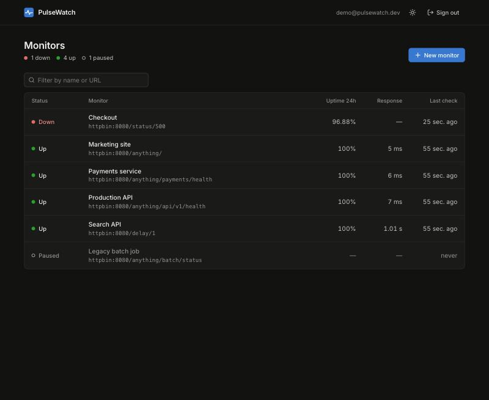
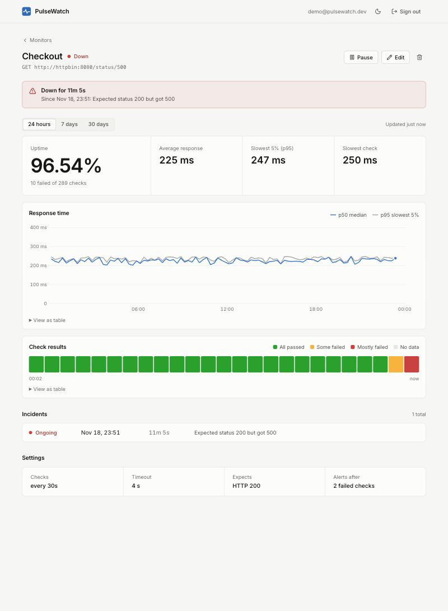
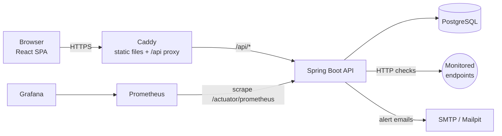
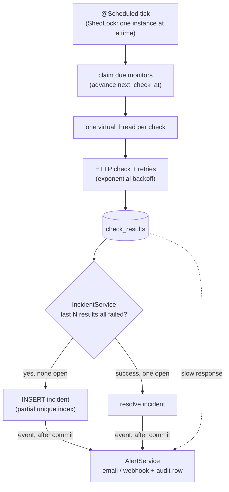

# PulseWatch

**API uptime monitoring that alerts once per outage.** Add a URL; PulseWatch checks it on a schedule, records every result, opens an incident after N failures in a row, emails you once when it goes down and once when it recovers, and shows uptime, latency percentiles and incident history on a dashboard.

Spring Boot 4 · Java 25 (virtual threads) · PostgreSQL 17 · React 19 + TypeScript · Docker · Prometheus + Grafana

| Monitors | One monitor |
|---|---|
|  |  |

## Run it (3 commands)

```bash
git clone <this repository> pulsewatch && cd pulsewatch
docker compose up --build
# then open http://localhost:8088 and create an account
```

That starts everything: PostgreSQL, the API, the web UI, a local test website (httpbin), a fake mail server, Prometheus and Grafana.

| What | Where |
|---|---|
| The app | http://localhost:8088 |
| Alert emails (Mailpit, nothing leaves your machine) | http://localhost:8025 |
| Metrics dashboard (Grafana, no login, local only) | http://localhost:3001 |
| API docs (Swagger UI) | http://localhost:8080/swagger-ui/index.html |

Try it: add a monitor for `http://httpbin:8080/status/200` (healthy) and one for `http://httpbin:8080/status/500` (failing; set "Alert after" to 2). After about a minute the second turns **Down**, and a "DOWN" email appears in Mailpit. Edit its URL to `/status/200` and a "RECOVERED" email follows. Real public sites such as `https://api.github.com` work too. (Private and internal addresses are normally refused; this local stack allows them only so the bundled httpbin can be monitored.)

To check a running stack yourself: `scripts/smoke-test.sh`.

## Develop it

```bash
docker compose up -d postgres httpbin mailpit prometheus grafana   # only the supporting services
./mvnw spring-boot:run                                             # API on :8080 (profile "local")
cd frontend && npm install && npm run dev                          # UI on :5173, proxies /api to :8080
```

```bash
./mvnw test                  # backend: ~220 tests; needs Docker (Testcontainers starts a real PostgreSQL)
cd frontend && npm test      # frontend: ~85 tests (Vitest + Testing Library)
```

CI (`.github/workflows/ci.yml`) runs both test suites, builds both Docker images, starts the whole stack and runs the smoke test; pushes to `main` publish the images to GitHub Container Registry.

## Architecture



Inside the API, one feature per package, each layered controller → service → repository:



| Package | Responsibility |
|---|---|
| `monitor` | monitor CRUD, validation (including "timeout shorter than interval") |
| `check` | scheduler, HTTP checker, retry policy, SSRF guard, check metrics |
| `incident` | incident state machine, history API |
| `alert` | notifiers (email, webhook), cooldown, audit log |
| `stats` | uptime, percentiles, chart buckets, nightly rollup |
| `auth` | register/login, JWT, BCrypt, rate limiting |
| `frontend/` | the React dashboard |

## Design decisions

**A modular monolith, not microservices.** One deployable, one database, strict package boundaries. A single developer gets transactions, simple debugging and cheap deployment; the packages talk through plain method calls and a few events, so a split would be possible later.

**Exactly one incident per outage, enforced by the database.** `IncidentService` checks for an open incident first, but the real guarantee is a partial unique index: `UNIQUE (monitor_id) WHERE resolved_at IS NULL`. Two racing writers cannot both open one; the loser's insert fails and is ignored. One alert per outage follows because alerts are triggered only by the state change (closed to open, open to resolved).

**"N failures in a row" is derived, not counted.** The count comes from the last N rows of `check_results`, not a counter column on `monitors`: Hibernate rewrites whole rows, so a counter and the scheduler's `next_check_at` update would overwrite each other.

**The scheduler claims before it checks.** A tick moves `next_check_at` forward in a short transaction, then runs the (slow) HTTP checks on virtual threads, so a slow target never makes the next tick pick the same monitor again. With several instances, ShedLock (a row in a `shedlock` table, using the database clock) lets only one run the claim step at a time. A test scans the code and fails the build if any `@Scheduled` method lacks `@SchedulerLock`.

**Events fire after the commit.** Down/recovered alerts are `@TransactionalEventListener(AFTER_COMMIT)` handlers running `@Async`: if the incident transaction rolls back nobody is told about an incident that does not exist, and a slow mail server never delays a check.

**Retries cannot make checks overlap.** A check retries up to 3 times with doubling backoff, but only as many attempts as fit before the monitor's next check is due (`attemptsThatFit`). The rule "timeout < interval" is enforced twice, in the API and as a database `CHECK`, because the API is not the only thing that can write to a database.

**Percentiles are computed in SQL, and only where they are exact.** `percentile_cont` over successful checks of the raw rows. Raw rows are kept 7 days; a nightly job (rollup first, delete second, one transaction) summarises every complete hour into `check_results_hourly`. Counts and sums add up exactly, so 30-day uptime stays exact; percentiles cannot be rebuilt from summaries, so latency charts stop at 7 days instead of showing a made-up number. Queries read rollups before a boundary and raw rows after it, so nothing is counted twice.

**Other people's monitors return 404, not 403.** A 403 confirms the monitor exists. Every monitor, stats and incident query is filtered by the caller's user id, and a cross-user integration test covers each endpoint.

**Metrics never carry a monitor id.** Tags have a handful of values (`result=up|down`), because the number of time series, not the number of requests, is what overloads a metrics system. Per-monitor numbers come from the stats API.

**SSRF protection.** A monitoring service calls whatever URL a user gives it, so a monitor could target `http://169.254.169.254/` (cloud credentials) or the database port. Monitors may only point at public addresses: the hostname is resolved and every address must be public, checked when a monitor is saved and again before every check; redirects are never followed. The local-development profile relaxes this because its test target lives on localhost.

**The dashboard has no chart library.** Two small hand-drawn SVG charts give exact control over the visual rules (2px lines, hairline grid, one accent colour, status colours only next to a word) and keyboard, hover and table access. Colours are design tokens, with light and dark themes.

## API at a glance

`POST /api/auth/register` · `POST /api/auth/login` return a JWT. Everything else needs `Authorization: Bearer <token>`.

| Endpoint | |
|---|---|
| `GET/POST /api/monitors`, `GET/PUT/DELETE /api/monitors/{id}`, `POST /api/monitors/{id}/pause\|resume` | monitor CRUD |
| `GET /api/monitors/overview` | the list with current status, last latency, 24 h uptime |
| `GET /api/monitors/{id}/stats` | uptime 24 h / 7 d / 30 d, latency percentiles, open incident, 24 h error buckets |
| `GET /api/monitors/{id}/error-rate?window=24h\|7d\|30d` · `/latency?window=24h\|7d` | chart data |
| `GET /api/monitors/{id}/incidents?page=0&size=20` | incident history, paginated |

Errors are RFC 9457 `ProblemDetail` JSON. Full reference: Swagger UI.

## Security notes

BCrypt passwords; HS256 JWT (12 h) verified by Spring Security's resource server; login and registration are rate limited (per account and per IP); CSRF is not needed because no cookies are used; the web server sets a strict Content-Security-Policy and other security headers; only `/api` is exposed to the internet (not `/actuator`, not Swagger); the API container runs as a non-root user; secrets come from environment variables and the production compose file refuses to start without them. Known limits: a token stays valid until it expires (no logout list), the rate limiter counts per instance, DNS rebinding between the SSRF check and the connection is not fully closed (an egress firewall would), and the JWT is kept in `localStorage`.

## Deploy

[docs/DEPLOY.md](docs/DEPLOY.md) walks through putting it on a single server with HTTPS (Docker, a domain and about ten minutes). `deploy/compose.prod.yaml` is the production stack.

## What I would do next

- Shared rate-limit counters and token revocation (Redis, or a table) for multi-instance deployments
- Per-monitor alert channels (Slack, per-user webhooks) and alert routing rules
- Public status pages per user
- SSL certificate expiry checks and multi-region checks
- A load test to measure how many checks per minute one instance sustains (the app is built for it, but there are no measured numbers here yet)
- TimescaleDB or partitioning for `check_results` at a much larger scale
